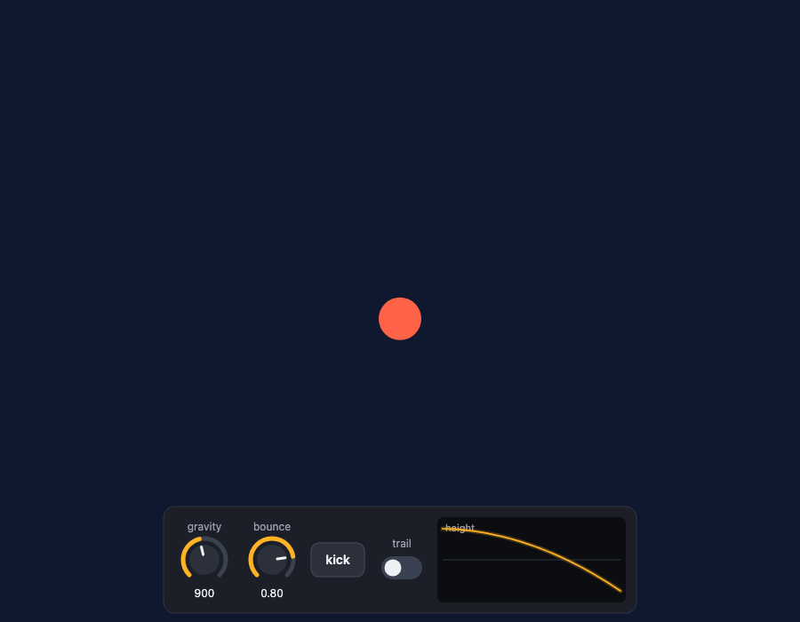
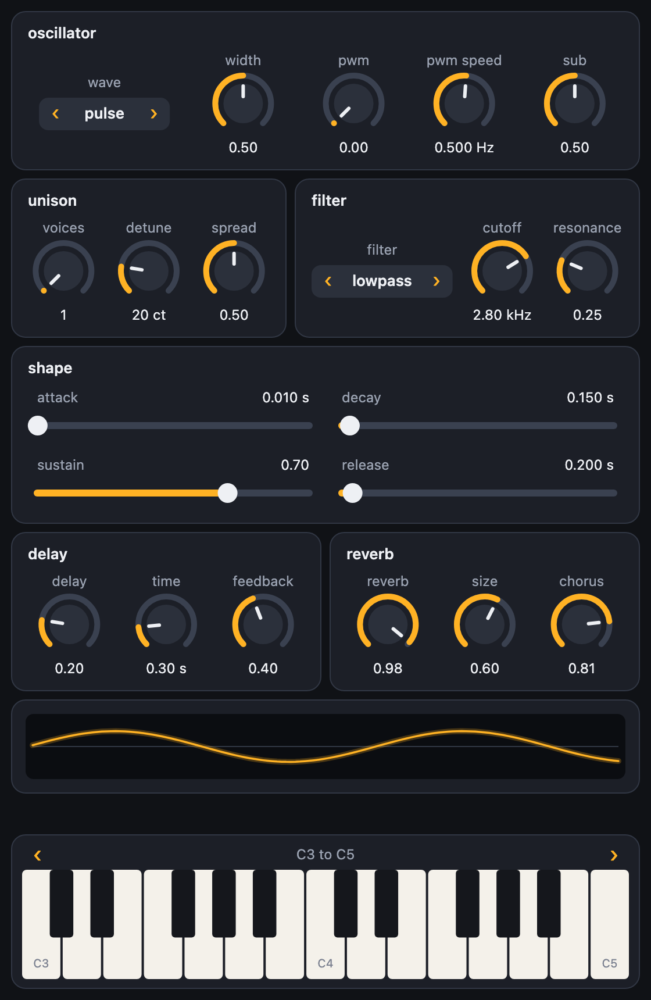
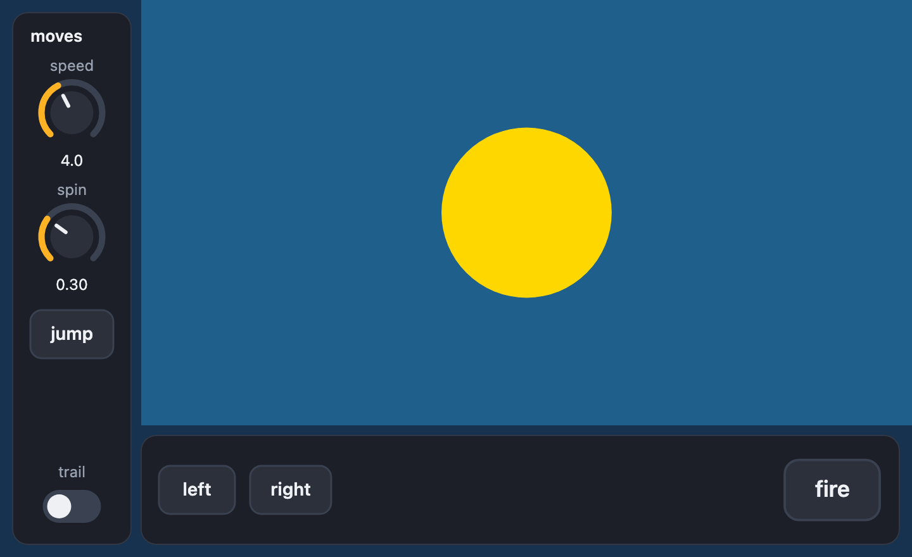

# dials.js

[](LICENSE)


dials.js puts dials, sliders, buttons, switches, a piano keyboard, a scope and level meters on a [pictures.js](https://github.com/johnwylie70/pictures.js) scene, in plain JavaScript, and it is for enjoying. It is for any age and any level: you write one line and a dial appears, and you turn it and something changes. There is nothing to position, nothing to draw and nothing to wire up. It works with a finger (several at once on the keyboard), with the mouse and with the computer's keys. It is a sibling of [pictures.js](https://github.com/johnwylie70/pictures.js) and [synths.js](https://github.com/johnwylie70/synths.js), designed for projects made in [Circuitry Studio](https://www.circuitry.dev), and runs anywhere a browser does.

Prefer Python? [pydials](https://github.com/johnwylie70/pydials) is the same library for [Pyctures](https://github.com/johnwylie70/pyctures).

## Start with four small scenes

Each one is a whole program. In a pictures.js scene the names are ready, with nothing to import. [How to run one](#run-it) is just below.

**1. A dial is a number.**

```js
const size = dial("size", 10, 150, 60)       // from 10 to 150, starting at 60

function draw() {
  background("midnightblue")
  circle(width / 2, height / 2, size.value, "gold")
}
```

`size.value` is the number the dial is on now. In a sum the dial stands for its number (`size * 2`), and `size.value = 100` sets it. Hold Shift while you turn for fine steps, and tap twice to put it back to 60.

**2. Buttons and switches.**

```js
layout({ at: "bottom" })                     // the controls go along the bottom
const gravity = dial("gravity", 0, 2000, 900)
const kick = button("kick")
const trail = toggle("trail")

let y = 100, speed = 0

function update(dt) {
  if (kick.pressed) speed = -700             // true once for each press
  speed += gravity.value * dt
  y += speed * dt
  if (y > height - 200) { y = height - 200; speed = -speed * 0.8 }
}

function draw() {
  background(trail.on ? "rgba(16, 24, 48, 0.08)" : "rgb(16, 24, 48)")
  circle(width / 2, y, 24, "tomato")
}
```



A `button` is asked in `update`: `kick.pressed` is true once for each press, and `kick.held` for as long as it is down. A `toggle` is a switch: `trail.on` is true or false. `select("level", ["easy", "hard"])` is one of a list. The controls line themselves up in the order you make them; `row()` starts another line. [Laying it out](#laying-it-out) has the rest.

**3. A synth you can play.**

```js
const lead = makeSynth("lead")

dial("cutoff", lead, "cutoff")
dial("resonance", lead, "resonance")
slider("attack", lead, "attack")
scope(lead)
keyboard(lead, { octave: 4 })
```

Each dial is that setting of the synth: it takes its range, its unit and where it starts from the synth, and turning it sets it. The scope draws the wave the synth is making. The keyboard plays it: with fingers, with the mouse, and with the keys A S D F G H J (the white keys) and W E T Y U (the black ones); Z and X step down and up an octave. `makeSynth` is from [synths.js](https://github.com/johnwylie70/synths.js), which pictures.js also has ready.

**4. Watch a number.**

```js
const graph = scope("height")
const level = meter("speed")
let t = 0

function update(dt) {
  t += dt
  graph.push(Math.sin(t * 2) * 100)            // one more point on the line
  level.value = Math.abs(Math.cos(t * 2))      // from 0 to 1
}
```

A scope with nothing behind it draws whatever you `push`, so you can watch any number change: a ball's height, a score, a speed. A meter shows a level from 0 to 1.

## Run it

Save a scene as `panel.js` and run it with pictures.js:

```bash
npx pictures run panel.js
```

Your browser opens on the scene. Save the file and it runs again.

On a page of your own, without pictures.js, import the functions. With one canvas on the page they find it themselves:

```js
import { dial, keyboard } from "./dials.js"
```

With more than one canvas, say which: `const { dial, keyboard } = dials(canvas)`.

The scenes in `examples/` run from a copy of this repository with nothing else installed but pictures.js: `npx pictures run examples/synth_panel.js`. They load `dials.js` from beside them with `await use("dials.js")`, and use a small stand-in synth (`examples/standin-synth.js`, the browser's own oscillators) so that they need no other library.

## With your hands

- Drag up or to the right on a dial to turn it up. The drag is the dial's until you let go, wherever the pointer wanders: off the dial, off the picture.
- Hold Shift to turn a tenth as far. On a touch screen, pull your finger well away from the dial for a quarter.
- Tap twice to put a dial or slider back where it started.
- Tap a slider's track and the handle comes to your finger; drag the handle to move it from where it is.
- Each finger on the keyboard holds its own key, and sliding along plays each key in turn.
- On a touch screen the controls are made a little bigger, for fingers.

## Laying it out

**There is nothing to do.** Controls line up in the order you make them, on a plate, with the keyboard along the bottom. On a narrow screen the line wraps evenly (six dials are three and three, never five and one), on a touch screen everything is a little bigger, and when the picture changes size it is all laid out again. Controls are drawn a little smaller before a line has to wrap, but never tiny: when there is more than fits, the plates can be moved with a finger, the mouse wheel or the bar beside them, while the keyboard and the scope above it stay where they are.

**A label is a heading.** A `label` made just before some controls is the title of their plate, and they are kept together: a plate moves to the next line whole, never leaving its heading behind. `row()` starts a new line of plates. This is a whole synth panel, and it needs nothing else:

```js
label("oscillator")
select("wave", lead, "wave")
dial("width", lead, "width")

row()
label("unison")
dial("voices", lead, "voices")
dial("detune", lead, "detune")
label("filter")
dial("cutoff", lead, "cutoff")
dial("resonance", lead, "resonance")
```



**Groups.** `group` says the same thing out loud, and takes options. What the function makes is in the group:

```js
group("filter", () => {
  dial("cutoff", lead, "cutoff")
  dial("resonance", lead, "resonance")
})
```

Or in a straight line, with no brackets to match: `group("filter")` and then its controls, until the next `group`, `row()` or `page`. The plates of a line share its width and are as tall as each other, and every line is as wide as the widest, so the panel looks made rather than poured. `examples/front_panel.js` is a whole synth in seven groups:


**Inside a group**, controls stand in a line. To arrange them another way, put these in it (they nest):

| | |
|---|---|
| `row(() => { … })` | In a line. (`row()` with nothing in it starts a new line.) |
| `column(() => { … })` | One under another. |
| `grid(3, () => { … })` | Three to a line, in columns that line up; fewer where three will not fit. `{ span: 2 }` on a control covers two columns. |
| `spacer()` | All the room that is left over, so what follows is pushed to the far end. `spacer(20)` is 20 points. |
| `{ size: "small" }`, `"large"` | On any control. A dial, slider and meter also take a number. |
| `{ share: 1 }` | On a control or a group: it takes the room its line has left over. Two things with shares of 2 and 1 split the line two to one. |

A group takes `colour` (for its title and every control in it), `columns: 3` (a grid), `gap`, `align` (`"start"`, `"center"`, `"end"`; left out, its controls are spread along the line), `dividers: true` (a line between the groups inside it) and `plate: false`.

```js
group("filter", { colour: "deepskyblue" }, () => {
  column(() => { select("kind", lead, "filter"); toggle("drive") })
  grid(2, () => {
    dial("cutoff", lead, "cutoff", { size: "large", span: 2 })
    dial("resonance", lead, "resonance", { size: "small" })
    dial("chorus", lead, "chorus", { size: "small" })
  })
})
```

**Pages.** When there is too much for one screen, give it pages. Each has a tab; the keyboard, and what is made before the first page and after the last, stay on every page.

```js
page("osc")
group("oscillator"); select("wave", lead, "wave"); dial("width", lead, "width")
page("filter")
group("filter"); dial("cutoff", lead, "cutoff"); dial("resonance", lead, "resonance")
page()                      // the pages end here
scope(lead)
keyboard(lead)
```

`page("fx", () => { … })` works too, and `fx.show()` turns to a page from your code.


**Along an edge, and the room that is left.** `layout({ at: "bottom" })` puts the plates at the bottom, and `"left"` or `"right"` in a column down that side. One group can be a strip along an edge, and `room()` is the rectangle no control is on, for the scene to draw in:

```js
group("moves", { at: "left" }, () => { dial("speed", 0, 10, 4); button("jump"); spacer(); toggle("trail") })
group({ at: "bottom" }, () => { button("left"); button("right"); spacer(); button("fire", { size: "large" }) })

function draw() {
  const area = room()                     // { x, y, width, height }
  rect(area.x, area.y, area.width, area.height, "steelblue")
}
```



**Exactly where you say.** `{ x, y }` on a control or a group places its top left corner, and `control.place(x, y)` moves it. With `layout({ design: [800, 480] })` those numbers are in a panel 800 by 480 that is scaled to fit the picture, so a front panel drawn once is right on every screen:

```js
layout({ design: [800, 480], image: "panel.png" })      // a picture behind the controls
dial("cutoff", lead, "cutoff", { x: 360, y: 30, size: "large" })
group("osc", { x: 20, y: 20, width: 300 }, () => { select("wave", lead, "wave"); dial("sub", lead, "sub") })
keyboard(lead, { x: 20, y: 340, width: 760, height: 120 })
```

**The look.** `layout` also takes `compact: true` (less room around everything), `dividers: true`, `plates: false` (no plates: a picture of your own behind), `backdrop` (a colour), `image`, `align: "center"` (plates keep their own widths) and `scale`. `theme({ accent: "deepskyblue", plate: "#20242c" })` is still one call for the colours.

## The controls

Every control takes a last `{ … }` of options. All of them take `x` and `y` (to place it by hand: its top left corner), `colour`, `size`, `share` and `span`.

| | |
|---|---|
| `dial(label, min, max, start)` | A dial. Options: `step`, `unit`, `log` (turned by ratio, as a pitch is), `digits`, `size`, `onChange`. |
| `dial(label, target, "setting")` | A dial that is a setting of a target. The label may be left out: `dial(lead, "volume")`. |
| `slider(…)` | The same as a dial, as a slider. `{ vertical: true }` stands it upright. |
| `button(label, onPress)` | A button. `fire.pressed` is true once for each press; `fire.held` while it is down. |
| `toggle(label, on)` | A switch. `mute.on` is true or false. `toggle(label, target, "setting")` ties it to a setting. |
| `select(label, choices, start)` | One of a list, stepped through with the arrows at its sides. `wave.value` is the choice, `wave.index` its place. `select(label, target, "setting")` takes the choices from the target. |
| `keyboard(target, { octave, octaves })` | A piano keyboard along the bottom. `piano.notes` is what is held now (60 is middle C). Options: `keys: false` (no computer keys), `hints: false` (no letters on the keys), `onNoteOn(note, velocity)`, `onNoteOff(note)`. |
| `scope(source)` | A line of numbers, live: a target with `samples()`, a function that returns a list, or a list. With no source, `graph.push(value)` adds a point. Options: `min`, `max`, `width`, `height`, `points`. |
| `meter(source)` | A level from 0 to 1 as a bar of lights: a target with `level()`, a function, or `level.value = 0.7`. `[left, right]` makes two bars. |
| `label(text)` | Words. Made just before some controls, it is their heading. |
| `group`, `row`, `column`, `grid`, `page`, `spacer` | What goes with what: see [Laying it out](#laying-it-out). |
| `layout({ at: "bottom" })` | Where the plates go (`"top"`, `"bottom"`, `"left"`, `"right"`), `scale`, `margin`, `compact`, `dividers`, `plates`, `align`, `backdrop` (true, false or a colour), `image` and `design`. |
| `room()` | The rectangle no control is on: `{ x, y, width, height }`. |
| `theme({ accent: "deepskyblue" })` | The colours. |
| `over(x, y)` | Is a control (or a tab, or the bar beside plates that can be moved) at this point? A game asks before it treats a click as its own. |

Every control has `value`, `label`, `remove()` and `place(x, y)`. `onChange(value)` is called when a hand changes it.

## Targets

A control can be tied to anything. No library is named: a target is known by what it can do, and every part is optional.

| | |
|---|---|
| `set(name, value)`, `get(name)` | Without them the control reads and writes `target[name]`, so a plain object is a target: `dial("size", ball, "radius", { min: 5, max: 80 })`. |
| `describe(name)` | `{ min, max, default, unit, step, digits, kind, choices, name }`. `kind` is `"float"`, `"int"`, `"bool"` or `"choice"`; `choices` is a list, or names joined by `\|`. |
| `noteOn(note, velocity)`, `noteOff(note)` | What a keyboard plays. `note` is a MIDI number, `velocity` is from 0 to 1. |
| `notes()` | The notes sounding now: a keyboard lights them. |
| `samples()` | Its latest output, numbers from -1 to 1: a scope draws it. |
| `level()` | How loud it is now, from 0 to 1, or `[left, right]`: a meter shows it. |

A target that is changed some other way (by the scene's code, by a song) moves its controls. The Python spellings (`note_on`, `on_change`) are understood too.

## How it is made

The controls are drawn on a canvas of their own, laid exactly over the scene's. So they sit on whatever the scene draws, 2D or 3D, need no call in `draw()`, and cost the scene nothing: only a control that changed is drawn again. A scene that draws nothing at all is given a dark backdrop. Pointers and keys are heard on the scene's own canvas, so the scene's `mouse`, `touches` and `keys` go on working.

A host that keeps the scene's code somewhere else (pydials does) makes controls and groups by number and is told what changed once a frame: `make`, `set`, `call`, `drop`, `listen`, `beat` and `ack` on what `dials(canvas)` gives. A group made that way is gone into and left with `call(id, "enter")` and `call(id, "leave")`, and the rectangle no control is on comes with a frame as `f` when it changes.

## Tests

```bash
PLAYWRIGHT=/path/to/node_modules/playwright node scripts/test-dials.mjs
```

Real browsers (Chromium, and WebKit when Playwright has it) on pictures.js scenes: the controls are turned, pressed and played with a real mouse, the keyboard and several fingers, and every example is run. Then the layout is measured at four sizes of screen (a phone, a tablet's split view, a tablet on its side, a desktop window): nothing overlaps or leaves the picture, a heading is on the same plate as its controls and above them, wrapped lines are balanced, a finger's target is never under 44 points, what does not fit is moved rather than shrunk, and a dial on plates that were moved or on a page that was turned to still keeps to the finger. No sound is made. pictures.js is taken from the folder beside this one.

## Licence

MIT. See [LICENSE](LICENSE).
